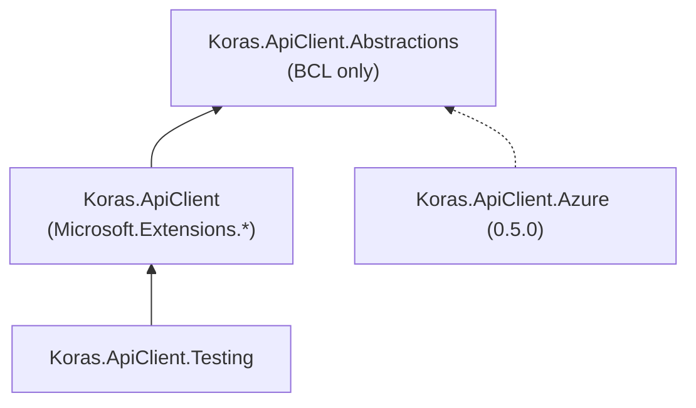
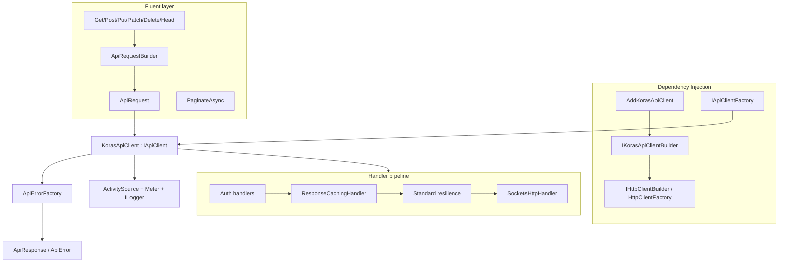
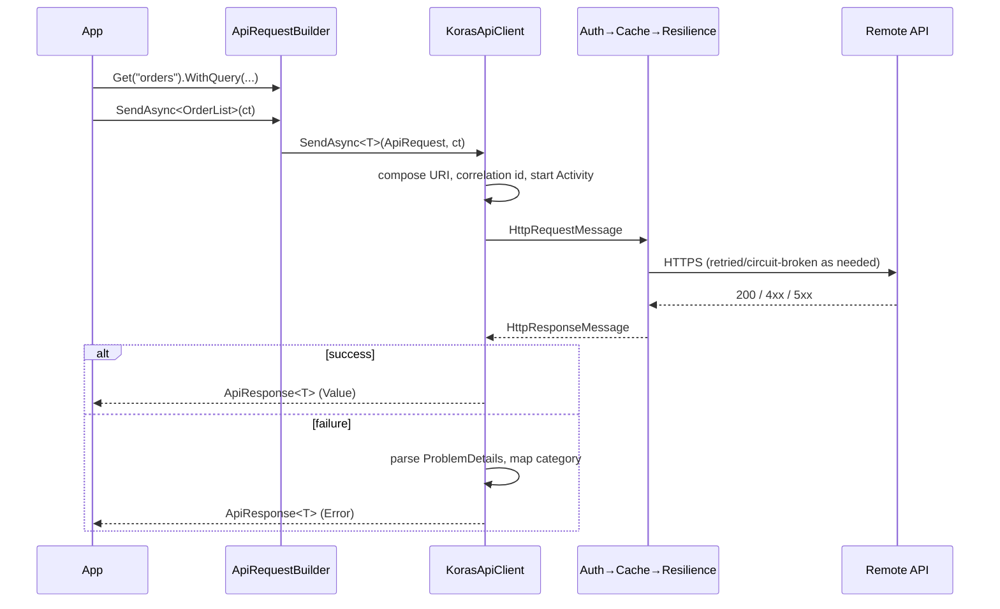
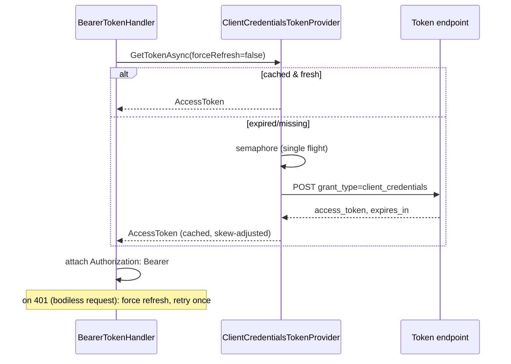
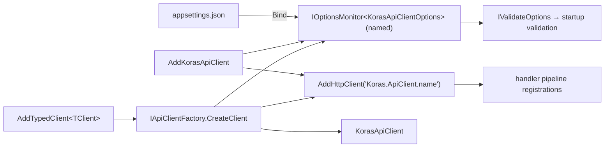

# Architecture Diagrams

## Package dependency diagram

## Component architecture

## Request lifecycle (sequence)

## Provider (token) lifecycle

## Dependency-injection flow

Error lifecycle diagram: see [error-model.md](error-model.md). Telemetry flow: see [observability.md](observability.md).
