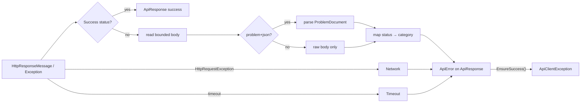

# Error Model

## Philosophy

**Outcomes are data; exceptions are opt-in.** `SendAsync` never throws for HTTP or transport failures — it returns `ApiResponse` whose `Error` explains what happened. Callers preferring exceptions call `EnsureSuccess()` / `GetValueOrThrow()` and catch the single `ApiClientException` type.

The only exceptions that escape `SendAsync`:

| Exception | When |
|---|---|
| `OperationCanceledException` | the caller's token was cancelled (standard .NET contract) |
| `ArgumentException` / `InvalidOperationException` | programmer errors (null request, no base address with relative path) |

## Category mapping

| Condition | `ApiErrorCategory` | Transient? |
|---|---|---|
| DNS/socket/TLS failure (`HttpRequestException`) | `Network` | yes |
| Per-request or client timeout | `Timeout` | yes |
| 400, 422 | `Validation` | no |
| 401 | `Authentication` | no |
| 403 | `Authorization` | no |
| 404, 410 | `NotFound` | no |
| 409, 412 | `Conflict` | no |
| 408 | `Timeout` | yes |
| 429 | `RateLimited` (with `RetryAfter`) | yes |
| other 4xx | `Client` | no |
| 5xx | `Server` | yes |
| response body fails to deserialize | `Serialization` | no |
| anything else | `Unknown` | no |

`ApiError.Code` is machine-readable (`"http_404"`, `"network_error"`, `"timeout"`, `"deserialization_failed"`). `ApiError.IsTransient` reflects the table above so callers can implement app-level fallback.

## ProblemDetails (RFC 9457)

When a failure response carries `application/problem+json` (or parseable JSON with problem members), it is deserialized into `ProblemDocument` (type/title/status/detail/instance/errors + extension data) and attached to `ApiError.Problem`. Validation errors expose the conventional `errors` dictionary.

## Body capture

Failure bodies are captured up to `MaxErrorResponseBodyLength` (default 4096 chars, configurable, 0 disables) into `ApiError.ResponseBody` for diagnostics — bounded to protect memory and logs.

## Error lifecycle

