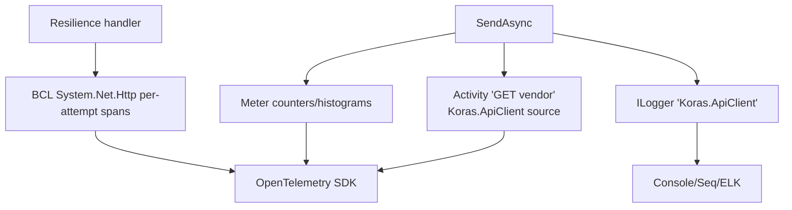

# Observability Architecture

## Tracing

- `ActivitySource` name: **`Koras.ApiClient`** (constant: `KorasApiClientTelemetry.ActivitySourceName`).
- One `Activity` per **logical operation** (`SendAsync`), named `{METHOD} {client}` (e.g. `GET vendor`) — retries performed by the resilience handler occur *inside* this span, alongside the BCL's own per-attempt `System.Net.Http` spans.
- Tags: `http.request.method`, `url.path`, `koras.client.name`, `koras.correlation_id`, `http.response.status_code`, `error.type` (category, on failure).

## Metrics

- `Meter` name: **`Koras.ApiClient`**.
- `koras.apiclient.requests` (counter) — tags: `koras.client.name`, `http.request.method`, `http.response.status_code`, `error.type`.
- `koras.apiclient.request.duration` (histogram, ms) — same tags.

## Logs

- Category `Koras.ApiClient` via source-generated `LoggerMessage`:
  - Debug: request starting (method, path, client, correlation id)
  - Information: request completed (status, elapsed ms)
  - Warning: request failed (category, code, status)
- **Redaction guarantees:** query strings are never logged (path only); `Authorization`, `X-Api-Key`, and cookie headers are never logged; token values never appear at any level.

## OpenTelemetry wiring (consumer side)

```csharp
services.AddOpenTelemetry()
    .WithTracing(t => t.AddSource(KorasApiClientTelemetry.ActivitySourceName).AddHttpClientInstrumentation())
    .WithMetrics(m => m.AddMeter(KorasApiClientTelemetry.MeterName));
```

No OpenTelemetry package dependency exists in the core — `ActivitySource`/`Meter` are BCL types, so the integration is zero-cost when no listener is attached.

## Telemetry flow


